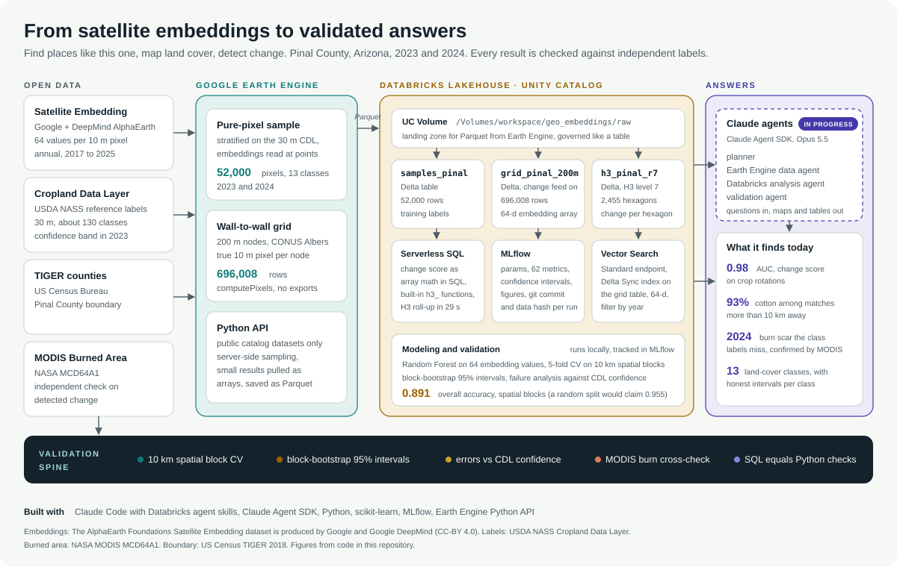

# geo-embeddings-agents

**Find places like this one.** An end-to-end workflow that turns Google's Satellite Embedding dataset in Earth Engine into validated land-cover maps, similarity search and change detection on Databricks, with a small team of Claude agents that answers plain-language questions and states how sure it is.



Read [how it works](docs/overview.md) for the datasets, the pipeline, why Databricks and H3, and what the validation shows. For a quick tour, open the [demo notebook](notebooks/demo.ipynb).

## Why
Satellite embeddings compress a year of observations for every 10 m pixel into 64 numbers. They make it easy to ask "where else looks like this?" But an embedding is only useful if we know when to trust it. This project puts validation at the center. Every result is checked against independent labels with spatially separated test data, and the weak spots are reported next to the strong ones.

## Workflow
1. **Earth Engine** samples embeddings with USDA Cropland Data Layer labels, and pulls a 200 m grid over all of Pinal County, Arizona, for 2023 and 2024.
2. **Databricks** stores them as Delta tables in Unity Catalog.
3. A **Random Forest** classifier is validated on 10 km spatial blocks and every run is tracked in **MLflow**.
4. **Vector Search** answers "find places like this one", and serverless SQL computes a year-to-year change score and rolls it up to **H3** hexagons.
5. **Claude agents** built on the Claude Agent SDK answer questions with read-only tools, and a validator agent checks each claim before the answer is returned.

## Results

### Land cover (13 classes)
Validated with 5-fold cross-validation on 10 km spatial blocks, so nearby pixels never sit on both sides of the split. Intervals are 95% block-bootstrap intervals.

| | Spatial blocks (honest) | Random split |
|---|---|---|
| Overall accuracy | 0.891 (0.868 to 0.913) | 0.955 |
| Kappa | 0.882 (0.857 to 0.904) | 0.951 |

- A random split hides about 59% of the errors. The gap is largest for spatially clustered crop classes such as Double crop, Corn+Sorghum and Orchards.
- Errors follow the reference label quality. Where the 2023 CDL confidence is under 50%, the model disagrees with CDL 30% of the time. At 99 to 100% confidence it disagrees 4% of the time.
- Cotton and Developed are the most reliable classes (F1 about 0.97). Double crop is the weakest (F1 0.78) and is mostly confused with its own component crops. Orchards scores F1 0.89, but the interval runs from 0.72 to 0.97 because one farm block holds about a quarter of its samples.

### Change, search and H3
- **Change.** One minus the cosine similarity of a place's 2023 and 2024 embeddings is a change score. It separates crop rotations from stable land with AUC 0.98 and crop to fallow with AUC 0.97. For flips between natural CDL classes it is near chance (0.56), which suggests many of those flips are relabeling.
- **A burn scar the labels miss.** The strongest change outside farmland sits inside an area NASA MODIS maps as burned in mid 2024. The CDL still calls it shrubland.
- **Find places like this one.** A Databricks Vector Search index over 696,008 grid vectors returns places of the same CDL class for 93% of matches more than 10 km from a cotton query. Results are weaker for mixed or rare classes such as woody vegetation (28%) and barren land (29%). The index agrees with exact search on answer quality, with a median query time of about a quarter of a second from a laptop.
- **H3.** The grid rolls up to 2,455 H3 hexagons in Databricks SQL, where the change score is computed as array math and matches Python exactly.

Figures are in [docs/figures/](docs/figures/), metrics in [docs/results/](docs/results/), and every training run is logged to MLflow on Databricks with its git commit and a hash of its data file.

### Agents
A planner agent leads three specialists. An Earth Engine agent fetches live per-place data, a Databricks agent runs read-only SQL, Vector Search and H3 hotspots, and a validator labels each claim Supported, Weak or Unsupported with numbers from the stored validation results and independent data. All nine tools are read-only, shell and file tools are removed, SQL passes a guard that allows only SELECT on the project tables, and spend is capped per question.

[docs/examples/](docs/examples/) shows three worked questions as tool walkthroughs. They run the agents' tools in a fixed order with no language model, so every number there comes straight from Databricks or Earth Engine and they cost nothing to run.

## Limitations
- Accuracy is agreement with the CDL, which has its own errors. It is not ground truth.
- The accuracy figures come from a class-balanced sample of pure pixels. They are not the accuracy of a wall-to-wall map, which would be lower at field edges and is dominated by shrubland.
- One county and two years. Results may not carry over to other regions without new validation.
- The embedding images are processed in tiles, and a faint seam is visible in the change map along 111° W.
- The agent team is built and its tools are tested against the live tables and Earth Engine, but the full team has not been run with a model in this repository. The examples are tool walkthroughs, not agent answers.

## Reproduce
Everything runs on free tiers. That means Databricks Free Edition, Earth Engine for noncommercial use, and a laptop. Only the optional live agent runs need a paid Anthropic API key.

1. Create the conda environment from the repo root. This also installs the project package in editable mode.
   ```
   conda env create -f environment.yml
   conda activate geo-embeddings
   ```
2. Authenticate Earth Engine with Google Application Default Credentials. The standard `earthengine authenticate` flow may be blocked for personal accounts.
   ```
   gcloud auth application-default login --scopes=https://www.googleapis.com/auth/earthengine,https://www.googleapis.com/auth/cloud-platform
   gcloud auth application-default set-quota-project <your-project>
   ```
3. Copy `.env.example` to `.env` and set `EE_PROJECT` to your Earth Engine Cloud project.
4. Install the [Databricks CLI](https://docs.databricks.com/dev-tools/cli/install.html) and sign in to your workspace.
   ```
   databricks auth login --host <your-workspace-url> --profile geo-embeddings
   ```
5. Check that everything works.
   ```
   python -m geo_embeddings.smoke                     # reads one embedding pixel
   databricks catalogs list --profile geo-embeddings  # lists Unity Catalog catalogs
   pytest
   ```
6. Build the labeled sample (about 10 minutes) and load it into Databricks as a Delta table.
   ```
   python -m geo_embeddings.build_samples        # writes data/processed/*.parquet
   databricks/load_samples.sh                    # creates workspace.geo_embeddings.samples_pinal
   ```
7. Train and validate the classifier. Add `--mlflow` to log the run to Databricks.
   ```
   python -m geo_embeddings.train_baseline       # 10 km spatial block CV
   python -m geo_embeddings.train_baseline --cv random
   python -m geo_embeddings.failure_analysis
   ```
8. Build the wall-to-wall grid, change score, H3 table and search index.
   ```
   python -m geo_embeddings.build_grid           # about 5 minutes, writes the 200 m grid
   databricks/load_grid.sh                       # creates workspace.geo_embeddings.grid_pinal_200m
   databricks/run_sql.sh databricks/sql/create_h3_table.sql
   python -m geo_embeddings.change_analysis
   python -m geo_embeddings.h3_map
   python -c "from geo_embeddings.search import *; w = workspace_client(); ensure_endpoint(w); ensure_index(w)"
   python -m geo_embeddings.search_eval --vs     # after the index finishes syncing
   ```
9. Run the agent tool walkthroughs (free), or the full agent team (needs `ANTHROPIC_API_KEY` in `.env`).
   ```
   python -m agents.demo                         # writes docs/examples/
   python -m agents.run --budget 3 "Where else in Pinal County looks like the field at -111.855, 33.082?"
   ```

`docs/plan.md` records every decision with its date and reasoning.

## Repository layout
```
src/geo_embeddings/   sampling, grid, validation, change, search, H3 and agent tools
agents/               Claude Agent SDK team (team.py), CLI (run.py), tool walkthroughs (demo.py)
databricks/           SQL for the Delta tables and loader scripts
notebooks/demo.ipynb  results tour that runs from committed files
docs/                 overview, architecture diagram, figures, results, examples, plan
tests/                pytest tests for the core logic
```

## Data sources
- **Google Satellite Embedding** (`GOOGLE/SATELLITE_EMBEDDING/V1/ANNUAL`), licensed CC-BY 4.0. The AlphaEarth Foundations Satellite Embedding [dataset](https://developers.google.com/earth-engine/datasets/catalog/GOOGLE_SATELLITE_EMBEDDING_V1_ANNUAL) is produced by Google and Google DeepMind.
- **USDA NASS Cropland Data Layer** (`USDA/NASS/CDL`). Public domain. Thanks to USDA NASS for the CDL.
- **NASA MODIS Burned Area** (`MODIS/061/MCD64A1`). Giglio, L., Justice, C., Boschetti, L., Roy, D. (2021). MODIS/Terra+Aqua Burned Area Monthly L3 Global 500m SIN Grid V061. NASA EOSDIS Land Processes DAAC. doi:10.5067/MODIS/MCD64A1.061
- **US Census TIGER 2018 counties** (`TIGER/2018/Counties`) for the Pinal County boundary.

## License
Code is released under the [MIT License](LICENSE). The datasets keep their own terms, listed above. Outputs derived from the Satellite Embedding dataset fall under CC-BY 4.0 and need its attribution.

## Author
Guillermo Ponce, PhD. Remote sensing data scientist, Tucson, Arizona.
