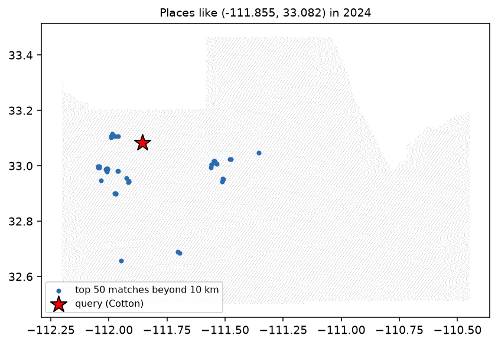

# Where else in Pinal County looks like the cotton field at -111.855, 33.082?

> **Scripted snapshot, no model involved.** These are the outputs of the agent team's read-only tools, run in a fixed order by `agents/demo.py` on 2026-11-13. A live run (`python -m agents.run`) lets Claude choose the tools and write the answer, with a validator agent checking it.

## 1. databricks-analyst · `place_profile(-111.855, 33.082)`

Nearest 200 m grid node -1464100_1234900 at (-111.85509, 33.08233), 38 m from the query.
CDL class 2023: Fallow/Idle (pure block: False, CDL confidence 69).
CDL class 2024: Cotton (pure block: True).
Embedding change 2023 to 2024: 0.460 (changed; threshold 0.14, crop changes are typically about 0.4).
H3 hexagon around it:
| h3_hex | n_nodes | change_mean | share_changed | share_cdl_changed | share_cropland_2024 | main_class_2024 |
|---|---|---|---|---|---|---|
| 8748e94d6ffffff | 152 | 0.267 | 0.763 | 0.697 | 0.855 | Cotton |

## 2. databricks-analyst · `find_similar(-111.855, 33.082, 2024, k=50, min_distance_km=10)`

Query node -1464100_1234900, CDL 2024 class Cotton.
Top 50 matches beyond 10 km (Databricks Vector Search, 64-d embeddings).
Same CDL class as the query: 86%. Class mix of matches: Cotton 86%, Alfalfa 6%, Fallow/Idle 4%, Corn+Sorghum 2%, Developed 2%.
Index score of match 1 and match 50: 0.9603, 0.9482.
Ten closest-in-embedding matches:
| lon | lat | class_name | dist_km |
|---|---|---|---|
| -111.5387 | 33.0081 | Cotton | 30.6 |
| -111.9476 | 32.6566 | Cotton | 48.1 |
| -111.3545 | 33.0478 | Cotton | 46.8 |
| -111.9707 | 32.8989 | Cotton | 23.1 |
| -112.0068 | 32.9901 | Cotton | 17.5 |
| -112.0128 | 32.9874 | Cotton | 18.1 |
| -111.5451 | 33.0181 | Cotton | 29.8 |
| -112.0061 | 32.9866 | Cotton | 17.6 |
| -111.5447 | 33.0164 | Cotton | 29.8 |
| -111.5472 | 33.0178 | Cotton | 29.6 |
Map saved: maps/similar_-111.855_33.082_2024.png

## 3. validator · `validation_evidence('search', 'Cotton')`

Share of top 50 matches beyond 10 km with the query's CDL class (30 pure queries per class, 2024). Vector Search agrees with exact search on answer quality (top-50 overlap 0.84, swaps are near-ties).
| class_name | precision_beyond_10km | precision_naive | share_of_county |
|---|---|---|---|
| Cotton | 0.925 | 0.923 | 0.018 |

## 4. validator · `validation_evidence('classification', 'Cotton')`

Random Forest on embeddings, 5-fold CV on 10 km spatial blocks, agreement with CDL on pure pixels. Overall accuracy 0.891 (95% 0.868 to 0.913). A random split would report about 0.955. Model error is 25 to 30% where 2023 CDL confidence is under 50 and 3 to 4% at 99 to 100.
| class | f1 | ci_95 | blocks |
|---|---|---|---|
| Cotton | 0.966 | 0.950 to 0.978 | 45 |
