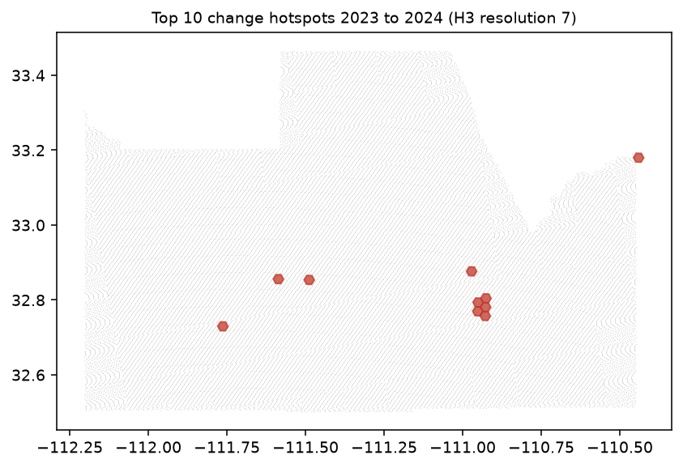

# Where did land outside farms change most from 2023 to 2024, and why?

> **Scripted snapshot, no model involved.** These are the outputs of the agent team's read-only tools, run in a fixed order by `agents/demo.py` on 2026-11-13. A live run (`python -m agents.run`) lets Claude choose the tools and write the answer, with a validator agent checking it.

## 1. databricks-analyst · `change_hotspots(top_n=10, max_cropland_share=0.05)`

share_changed = share of 200 m nodes with embedding change > 0.14; share_cdl_changed = share whose CDL class changed.
| h3_hex | lon | lat | n_nodes | share_changed | share_cdl_changed | share_cropland_2024 | main_class_2024 |
|---|---|---|---|---|---|---|---|
| 8748e869dffffff | -110.9267 | 32.7809 | 151 | 0.927 | 0.040 | 0.000 | Shrubland |
| 8748e868effffff | -110.9518 | 32.7697 | 152 | 0.855 | 0.158 | 0.000 | Shrubland |
| 8748e868affffff | -110.9507 | 32.7933 | 150 | 0.780 | 0.193 | 0.000 | Shrubland |
| 8748e8699ffffff | -110.9257 | 32.8044 | 150 | 0.653 | 0.020 | 0.000 | Shrubland |
| 8748e8683ffffff | -110.9278 | 32.7573 | 150 | 0.560 | 0.020 | 0.000 | Shrubland |
| 8748e8258ffffff | -111.7628 | 32.7296 | 148 | 0.514 | 0.385 | 0.000 | Shrubland |
| 8748ea208ffffff | -110.4401 | 33.1799 | 20 | 0.500 | 0.000 | 0.000 | Excluded |
| 8748eb90cffffff | -111.4881 | 32.8536 | 151 | 0.490 | 0.417 | 0.007 | Shrubland |
| 8748eb975ffffff | -111.5862 | 32.8557 | 149 | 0.403 | 0.832 | 0.034 | Shrubland |
| 8748ebd2effffff | -110.9715 | 32.8765 | 151 | 0.371 | 0.007 | 0.000 | Shrubland |
Map saved: maps/hotspots_top10_crop0.05.png

## 2. earth-engine-data · `burned_area(-110.9267, 32.7809, radius_km=2, 2020-2025)`

MODIS burned area (MCD64A1, 500 m) within 2.0 km of (-110.9267, 32.7809):
| year | burned_share | median_burn_day_of_year |
|---|---|---|
| 2020 | 0 |  |
| 2021 | 0 |  |
| 2022 | 0 |  |
| 2023 | 0 |  |
| 2024 | 1 | 194.0 |
| 2025 | 0 |  |

## 3. earth-engine-data · `cdl_history(-110.9267, 32.7809, 2020-2025)`

CDL at the 30 m pixel containing the point (USDA/NASS/CDL):
| year | cdl_code | cdl_name | grouped_class | confidence |
|---|---|---|---|---|
| 2020 | 152 | Shrubland | Shrubland | 100.0 |
| 2021 | 152 | Shrubland | Shrubland | 92.0 |
| 2022 | 152 | Shrubland | Shrubland | 100.0 |
| 2023 | 152 | Shrubland | Shrubland | 100.0 |
| 2024 | 152 | Shrubland | Shrubland |  |
| 2025 | 152 | Shrubland | Shrubland |  |

## 4. earth-engine-data · `embedding_change(-110.9267, 32.7809, 2023, 2024)`

Embedding change at (-110.9267, 32.7809) from 2023 to 2024: 0.124 (stable; threshold 0.14, which is about the 99th percentile of change where CDL saw no change in 2023 to 2024).

## 5. validator · `validation_evidence('change')`

Change score AUC against unchanged nodes, by CDL transition type (pure nodes both years). Near 0.5 means the score does not separate that transition from stable land. Natural-to-natural CDL flips are often relabeling, not land change.
| transition | n | median_change | auc |
|---|---|---|---|
| no change | 229515 | 0.027 |  |
| crop <-> fallow | 3647 | 0.375 | 0.973 |
| crop to crop | 2982 | 0.439 | 0.984 |
| farm <-> natural | 4010 | 0.078 | 0.86 |
| natural to natural | 2579 | 0.029 | 0.558 |
| to/from developed | 1097 | 0.031 | 0.597 |
| any change | 14315 | 0.156 | 0.84 |
