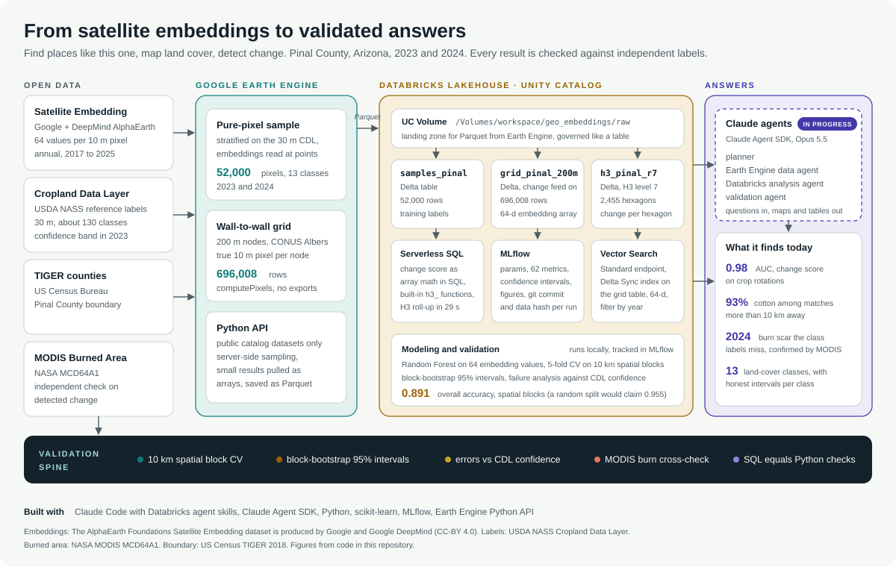

# How geo-embeddings-agents works

This project turns Google's Satellite Embedding dataset into answers that can be checked. It covers Pinal County, Arizona, a mix of irrigated farmland and desert rangeland, for 2023 and 2024. The core question is simple. Given one place, where else looks like it, what is it, and did it change? Every answer is compared against independent labels, and the comparison is part of the result.

## The data

| Dataset | What it gives us | Role |
|---|---|---|
| Google Satellite Embedding (AlphaEarth Foundations), `GOOGLE/SATELLITE_EMBEDDING/V1/ANNUAL` | 64 numbers per 10 m pixel per year, 2017 to 2025, summarizing a year of optical, radar and other observations | The features for every model, search and change score |
| USDA NASS Cropland Data Layer, `USDA/NASS/CDL` | A land-cover or crop label for every 30 m pixel, plus per-pixel confidence in some years | Reference labels for training and validation |
| US Census TIGER 2018 counties | County boundaries | The study area |
| NASA MODIS Burned Area, `MODIS/061/MCD64A1` | Monthly burned area at 500 m | An independent check on detected change |

All four are public. The embeddings are licensed CC-BY 4.0 and the CDL is public domain.

### Why embeddings

A satellite embedding is a compact summary of what a place looked like over a whole year. Google and Google DeepMind trained a model on many sensors and seasons so that places with similar land cover and land use end up with similar vectors. That changes the work. There is no compositing, cloud masking or index engineering before modeling. A Random Forest trained directly on the 64 values separates 13 land-cover classes. A dot product between two years is a change score. A nearest-neighbor search is "find places like this one."

The embeddings are not labels and not ground truth. They need a reference to say what a cluster of similar vectors means, which is why validation sits at the center of this project.

## The pipeline

**1. Earth Engine prepares the data.** The Earth Engine Python API does the heavy reading on Google's side and returns only small results.

- A stratified sample of 52,000 "pure" pixels, 2,000 per class per year. A pixel counts as pure when the 90 m block of CDL around it is a single class, which keeps field-edge label errors out of training.
- A wall-to-wall grid of 348,004 nodes per year at 200 m spacing. Each node holds the real 10 m embedding pixel at that spot. Asking Earth Engine for a coarse grid normally returns averaged values from its image pyramid, and an averaged embedding is not the embedding of any real place. Forcing evaluation at 10 m avoids that, and the vector lengths (0.991 to 1.009) confirm it.
- Data comes back as arrays through `computePixels`, about 2.5 minutes per year, with no export jobs.

**2. Databricks stores, governs and serves it.** Parquet files land in a Unity Catalog volume and become Delta tables.

- `samples_pinal` holds the training sample.
- `grid_pinal_200m` holds the full grid, with the 64 values as an array column and change data feed turned on.
- `h3_pinal_r7` holds the grid rolled up to H3 hexagons.

**3. Models are trained and validated.** The classifier runs in plain Python with scikit-learn on a laptop, since 52,000 rows train in seconds. Every run is logged to MLflow in the Databricks workspace.

**4. Search and change run on the lakehouse.** A Vector Search index over the grid table answers "find places like this one." Serverless SQL computes the change score and the H3 summaries.

**5. Agents answer questions (in progress).** A small team of Claude agents built with the Claude Agent SDK will take plain-language questions, call Earth Engine and Databricks as tools, and return maps and tables with the uncertainty stated. A planner splits the question, data and analysis agents do the work, and a validation agent checks the answer against labels before it is returned.

## Why Databricks for a remote sensing project

Earth observation work usually ends up as folders of GeoTIFFs and CSVs, scripts that only run on one laptop, and results nobody can trace back to their inputs. Databricks addresses each of those, and this project uses the specific pieces below.

**Unity Catalog keeps data, models and indexes in one governed place.** Tables, the raw file volume and the vector index live under one catalog and schema, next to the MLflow experiment in the same workspace. Each table carries its source, license and attribution in its description. Unity Catalog recorded lineage on its own, from each Parquet file in the volume to the table built from it, and from the grid table to the vector index. For a project that mixes licensed and public data, that matters.

**Delta tables make results reproducible and safe to rebuild.** The sample table was rebuilt when the class scheme changed from 11 to 13 classes. Delta kept every earlier version (18 so far for that table) available through time travel, and change data feed lets the vector index update incrementally when the grid changes.

**Serverless SQL does real geospatial work without a cluster to manage.** The change score between years is computed directly in SQL as array math on the 64-value columns, and it matches the Python result to six decimal places. Built-in H3 functions roll 348,004 grid nodes into 2,455 hexagons in about 29 seconds on the smallest warehouse.

**MLflow makes every number traceable.** Each cross-validation run stores its parameters, 62 metrics with confidence intervals, the confusion matrix figure, the git commit and a SHA-256 hash of the exact data file. Anyone can see which code and which data produced a figure in this README.

**Vector Search turns embeddings into a product feature.** A Delta Sync index on the grid table serves nearest-neighbor queries with a year filter, and it stays in step with the table. That is what lets an application or an agent ask "where else looks like this?" without scanning hundreds of thousands of vectors. From a laptop a query takes about a quarter of a second, network included. Against exact search the index returns 84% of the same top 50 places on average, and every place it swaps in is within 0.005 cosine of the one it replaced. The share of matches in the query's class is the same either way (86%).

**The same platform serves the agents.** The tables, SQL warehouse and vector index the analysis uses are the same ones the agents will call. There is no separate serving copy to keep in sync.

The project runs on the Databricks Free Edition. It allows one Vector Search endpoint and one small SQL warehouse, which was enough for a county.

## Why H3

H3 is a global grid of hexagons with a fixed hierarchy of resolutions. It was developed at Uber and is supported natively in Databricks SQL.

- **Cells of nearly equal size.** H3 cells are not exactly equal-area, but within a county they vary very little. A resolution 7 hexagon covers about 5.2 square kilometers on average, so summaries are comparable across the county in a way that counties or fields are not.
- **Simple joins.** Any point becomes a cell id with one function call (`h3_longlatash3`). Different datasets join on that id without spatial joins or shared projections.
- **Multi-scale by design.** Each cell has a parent and children, so the same analysis can zoom from regional hotspots to field scale.
- **A natural unit for agents.** "Which areas changed most?" becomes a sort over hexagons.

In this project the H3 table compares two views of change for each hexagon, the share of grid nodes whose embedding changed and the share whose CDL label changed. They agree on the farm belt (correlation 0.67 across hexagons). They disagree in an instructive way elsewhere. The CDL reports change across wide natural areas, while the embeddings stay stable there.

## MLOps practices

- **Code, not notebooks, holds the logic.** Reusable code lives in `src/geo_embeddings/` with type hints and 31 unit tests. Each result is produced by one command.
- **Runs are tracked.** MLflow stores parameters, metrics, intervals, figures, the git commit and a data hash for every cross-validation run.
- **Data is versioned twice.** Delta keeps table history, and the data hash in MLflow ties each run to the exact file.
- **Checks are built in.** The SQL change score is checked against Python. The refactored labeling code was checked against 300 stored samples. Vector Search results are checked against exact search, for overlap, similarity and class agreement.
- **Secrets stay out of the repo.** Project IDs, workspace URLs and tokens live in a gitignored `.env` file and the CLI's OAuth login.

## What the validation shows

**Land cover.** A Random Forest on the 64 embedding values reaches overall accuracy 0.891 (95% interval 0.868 to 0.913) and Kappa 0.882 on 13 classes, using 5-fold cross-validation on 10 km spatial blocks. The same model on a random split reports 0.955. A random split puts pixels from the same field on both sides of the split and hides about 59% of the errors.

**Errors follow label quality.** Where the 2023 CDL itself has under 50% confidence, the model disagrees with it 30% of the time. Where the CDL has 99 to 100% confidence, the model disagrees 4% of the time.

**Change.** The change score separates real farm changes from stable land very well (AUC 0.98 for crop rotations, 0.97 between crop and fallow). For flips between natural classes such as shrubland and grassland it is close to chance (AUC 0.56). That fits other signs that many of those CDL flips are relabeling rather than change on the ground.

**A change the labels miss.** The hexagons with the most embedding change outside farmland sit inside an area NASA's MODIS product maps as burned in mid 2024. The CDL still labels it shrubland. The embeddings caught a burn scar the class labels do not show.

**Similar places.** For a cotton field, 93% of the most similar places more than 10 km away are also cotton in the CDL. Results are weaker for mixed or rare classes such as woody vegetation (28%) and barren land (29%).

## Limitations

- Accuracy is measured against the CDL, which has its own errors. It is not ground truth.
- The accuracy figures come from a class-balanced sample of pure pixels. They are not the accuracy of a wall-to-wall map, which would be lower at field edges and is dominated by shrubland.
- Orchards and double crops come from few places, so their scores have wide intervals.
- One county and two years. Results may not carry over to other regions without new validation.
- The embedding images are processed in tiles, and a faint seam is visible in the change map along 111° W.
- The agents are still being built.

## Reproduce

See the Setup section of the [README](../README.md). Each step is one command, and `docs/plan.md` records every decision with its date and reasoning.
